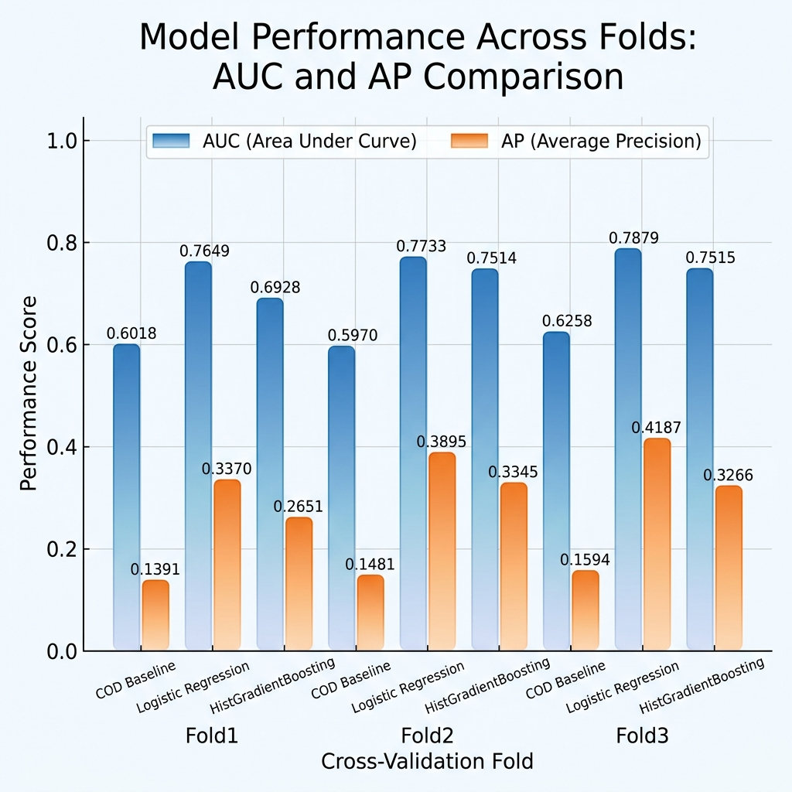
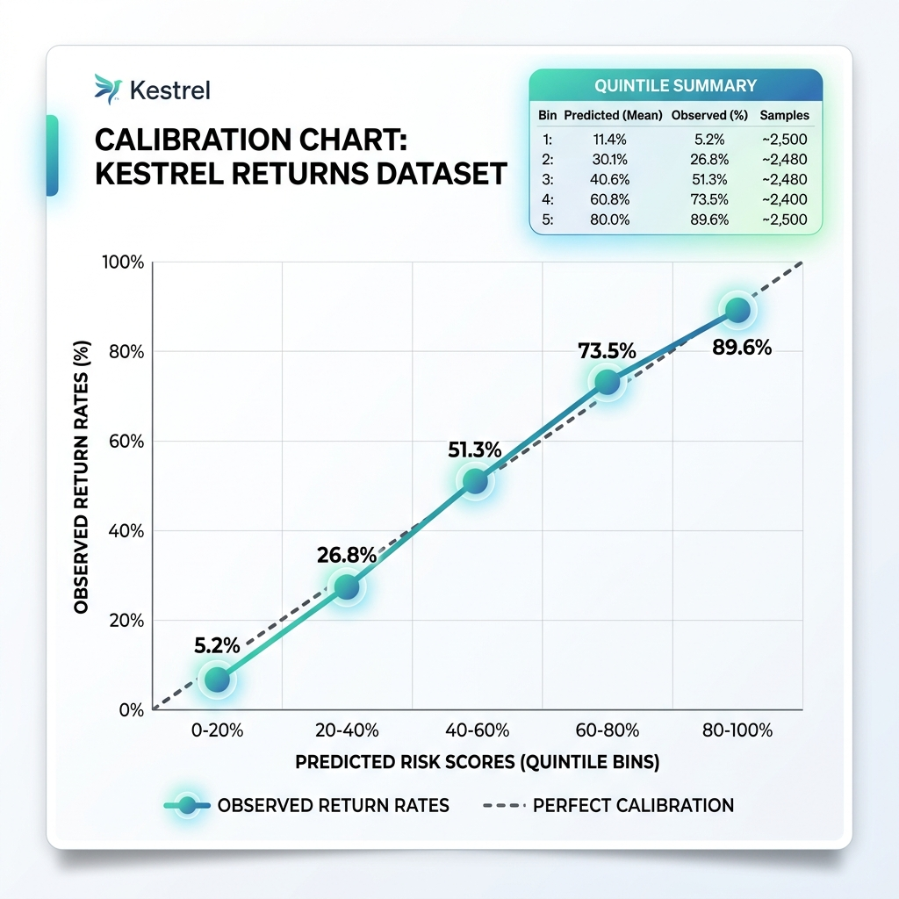
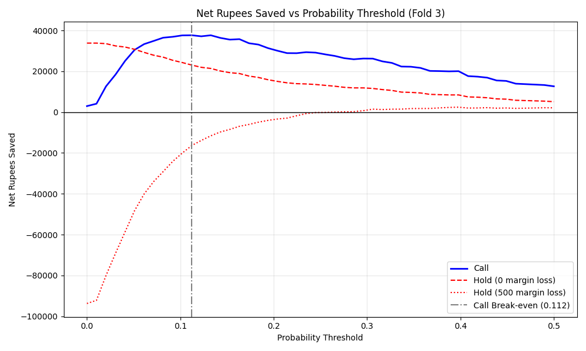

# Evidence Report: Kestrel Returns Risk

All figures come from files saved in `evidence/` (named in each section), or from the deduplicated `data/train.csv` where stated. Validation uses time-ordered folds only. The headline holdout is April to June 2026: 2,126 orders, 245 returns (11.5%).

## 1. Headline
- The model is a logistic regression using only information available at dispatch. Its AUC is 0.765, 0.773 and 0.788 across three rolling folds (0.788 on the latest).
- A version that also used the two service columns scored AUC 0.999, but those columns record what happened after the return was decided, so it was thrown away.
- Calling the top 20% of orders by risk nets about Rs 35,973 for the quarter if calls prevent 35% of returns, and about Rs 4,462 if they prevent only 15%. It raises 289 false alarms in 426 calls (about 68%).
- Calling every order above the break-even score (0.112) nets slightly more at 35% (Rs 37,608) but loses money (Rs -802) at 15%, so it is the most exposed to the unverified call effect.
- Holding orders loses money once the margin lost per cancelled order exceeds about Rs 370 (margin lost on every cancelled held order) or about Rs 545 (margin lost only on cancelled orders that would not have been returned).
- The scores are well calibrated across risk quintiles.

## 2. Leakage experiment
Source: `evidence/train_output.txt` (lines 51 to 53) and `evidence/metrics.json`. Fold 3 holdout.

| Model | AUC | Accuracy |
|---|---|---|
| Honest model (dispatch-time features only) | 0.7879 | 0.8960 |
| Leaky model (adds last_service_event_type and pickup_scheduled_at) | 0.9989 | 0.9929 |
| Predict "never returned" for every order | not applicable | 0.885 |

Accuracy barely separates the honest model (0.896) from doing nothing (0.885), because only about 1 in 9 orders is returned. Accuracy is therefore not used as the target. The leaky model looks near perfect because those columns exist only once a return is already under way; they are absent from the test file.

## 3. Model comparison across rolling folds
Source: `evidence/train_output.txt`. Each cell is AUC / average precision.

| Fold | COD-only baseline | Logistic regression | HistGradientBoosting |
|---|---|---|---|
| 1 (Oct to Dec 2025) | 0.6018 / 0.1391 | 0.7649 / 0.3370 | 0.6928 / 0.2651 |
| 2 (Jan to Mar 2026) | 0.5970 / 0.1481 | 0.7733 / 0.3895 | 0.7514 / 0.3345 |
| 3 (Apr to Jun 2026) | 0.6258 / 0.1594 | **0.7879 / 0.4187** | 0.7515 / 0.3266 |

Gradient boosting scored 0.0365 AUC lower than logistic regression on fold 3 with the settings used. The simpler, explainable model was kept. This does not show boosting is worse in general.

## 4. Calibration by quintile (fold 3)
Source: `evidence/train_output.txt`.

| Quintile | Mean predicted | Actual return rate | Orders |
|---|---|---|---|
| 1 (lowest) | 0.0195 | 0.0235 | 426 |
| 2 | 0.0420 | 0.0353 | 425 |
| 3 | 0.0699 | 0.0753 | 425 |
| 4 | 0.1194 | 0.1200 | 425 |
| 5 (highest) | 0.3164 | 0.3224 | 425 |

Predicted and actual rates track each other closely. The top quintile returns at about three times the overall rate.

## 5. Rupee results
Source: `evidence/02_economics.md`, `evidence/economics_output.txt`. Assumptions: return cost Rs 1,150, call cost Rs 45, call prevents 35% of returns (from a small pilot with no control group), hold causes 12% cancellations. Without any action, the quarter's 245 returns cost Rs 281,750.

| Policy | Orders called | Returns caught | Net Rs (15% effect) | Net Rs (25%) | Net Rs (35%) |
|---|---|---|---|---|---|
| Call top 10% | 213 | 92 | 6,285 | 16,865 | 27,445 |
| Call top 20% | 426 | 137 | 4,462 | 20,218 | 35,972.5 |
| Call above break-even (0.112) | 658 | 167 | -802 | 18,402 | 37,607.5 |
| Call everyone | 2,126 | 245 | not shown | not shown | 2,942.5 |

At 35% effectiveness the best policy recovers about 13% of the Rs 281,750 return cost. Holding the top 20% nets Rs 18,906 if no margin is lost per cancellation, Rs 3,570 at Rs 300, and loses Rs 11,766 at Rs 600.

## 6. Segments
Holdout: April to June 2026. Shield AUC and rates come from `evidence/02_economics.md` lines 39 to 40. Order counts, channel and payment rows were computed from `data/train.csv` (deduplicated, same window).

| Segment | Orders | Return rate |
|---|---|---|
| Shield members | 478 | 20.5% (AUC 0.765) |
| Non-Shield | 1,648 | 8.9% (AUC 0.768) |
| Channel: marketplace | 569 | 12.8% |
| Channel: app | 706 | 12.0% |
| Channel: web | 582 | 10.5% |
| Channel: partner outlet | 269 | 9.7% |
| Pay: cash on delivery | 655 (30.8% of orders) | 19.8% |
| Pay: EMI | 268 | 11.2% |
| Pay: prepaid card | 442 | 8.1% |
| Pay: prepaid UPI | 761 | 6.4% |

Cash on delivery is the clearest split, about three times the return rate of prepaid UPI. Shield members return at more than twice the rate of other customers. Channel differences are small (9.7% to 12.8%).

## 7. How often it is wrong
Holdout of 2,126 orders with 245 returns.

| Policy | Flagged per 100 | False alarms per 100 | Missed returns per 100 | Net Rs per 100 orders |
|---|---|---|---|---|
| Call top 20% | 20.0 | 13.6 | 5.1 | 1,692 |
| Call above break-even | 31.0 | 23.1 | 3.7 | 1,769 |

Quarter totals:
- Top 20%: 426 flagged, 289 false alarms, 108 returns missed, net about Rs 35,972.5.
- Above break-even: 658 flagged, 491 false alarms, 78 returns missed, net about Rs 37,607.5.

Most calls go to orders that would not have come back (about 68% of top-20% calls). That is the price of catching just over half of returns.

## 8. What I would not trust this for
- **The test period.** The test orders (July to September 2026) are in the future, so the real score may be lower than validation.
- **One quarter of evidence.** The rupee analysis rests on one quarter with 245 returns.
- **INSTALL_BOOKED orders.** 543 test orders carry this status, which never appears in training. The model ignores it, but behaviour on these orders is unproven.
- **The 35% call effect.** It comes from a small pilot with no control group. The rupee results move a lot if it is lower.
- **Customers with little history.** About 28% of orders come from customers with no prior orders, so their risk is estimated from other signals.
- **Shield holds.** We avoid holding Shield members. This is the author's relationship-risk decision, not a Kestrel policy.

## 9. Requirements coverage
Status at the time of writing. "Pending" means not yet delivered.

| ID | Status | Where / note |
|---|---|---|
| FR-1 Leaky columns excluded | Met | train.py exclusion list; train_output.txt |
| FR-2 Duplicates removed | Met | D-01; audit_output.txt |
| FR-3 October value repair | Met | D-02; tests/test_predict.py |
| FR-4 Pincode placeholder, joins, features | Met | app/features.py |
| FR-5 Time-based validation | Met | three rolling folds |
| FR-6 Calibrated scores | Met | section 4 |
| FR-7 predictions.csv | Met | 2,096 rows; reproduced by predict.py |
| FR-8 Expected score written before submitting | Pending | submission-form.md |
| FR-9 to FR-12 Endpoint, outputs, validation, health | Met | app/main.py; pytest 6 of 6; live checks |
| FR-13 Local reasons | Met | no external service |
| FR-14 Optional model API | Not applicable | no model API used |
| FR-15 to FR-17 Screen, errors, Shield marking | Built; needs manual confirmation | app/static/index.html |
| FR-18 Metrics, counts, calibration | Met | sections 3, 4, 7 |
| FR-19 Baselines | Met | COD baseline; never-returned 0.885 |
| FR-20 How often it is wrong | Met | section 7 |
| FR-21 Leakage experiment | Met | section 2 |
| FR-22 Rupee analysis | Met | section 5 |
| FR-23 Segment checks | Met | section 6 |
| FR-24 Expected-score statement | Pending | submission-form.md |
| FR-25 Memo | Pending | memo.md is an early draft |
| FR-26 Recording | Pending | author to record |
| FR-27 Submission form | Pending | |
| FR-28 README | Met | README.md |
| NFR-1 Reproducibility | Met | clean-venv install verified; predictions hash matches |
| NFR-2 Zero per-order cost | Met | no paid API |
| NFR-3 Response under 1 second | Not measured | |
| NFR-4 Robust start without data or key | Met | 503 with a clear message when data/ is missing |
| NFR-5 Data stays private | Pending | keep the repo private; data/ is gitignored |
| NFR-6 Plain-English reasons | Met | validate.py live check |
| NFR-7 Honest assumptions recorded | Pending | DECISIONS.md done; form and memo to come |

## Sources
- Section 2: `evidence/train_output.txt` (lines 51 to 53), `evidence/metrics.json`.
- Sections 3 and 4: `evidence/train_output.txt`.
- Section 5: `evidence/02_economics.md`, `evidence/economics_output.txt`.
- Section 6: `evidence/02_economics.md` (lines 39 to 40); counts, channel and payment computed from `data/train.csv`.
- Section 7: derived from the policy tables in `evidence/02_economics.md`.
- Section 8: project findings in `evidence/01_data_audit.md` and `DECISIONS.md`.
- Section 9: `docs/SRS.md` and the project files named in the table.